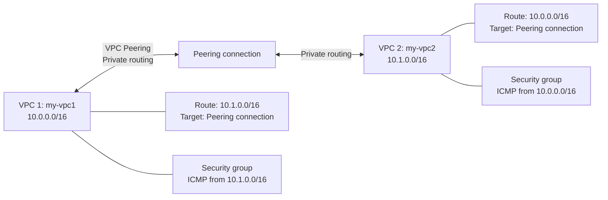

# AWS VPC Peering Lab

A hands-on AWS networking lab demonstrating how to connect two Virtual Private Clouds (VPCs) using VPC Peering and route tables.

> **Lab status:** The peering connection was verified as **Active** in the AWS console. The route in VPC 1 was shown as **Active**. Verify the VPC 2 route before describing the routing configuration as fully complete. End-to-end connectivity testing has not been confirmed.

## Architecture

- **Region:** Europe (Stockholm) — `eu-north-1`
- **VPC 1:** `my-vpc1` — `10.0.0.0/16`
- **VPC 2:** `my-vpc2` — `10.1.0.0/16`
- **Peering connection:** `conn-vpc`
- **Peering connection ID:** Do not publish AWS resource IDs in screenshots unless you are comfortable making them public.

### Architecture diagram

## What I configured

1. Created two VPCs with non-overlapping IPv4 CIDR ranges.
2. Created a VPC Peering connection and accepted the request.
3. Confirmed the peering connection status was **Active**.
4. Added a route in VPC 1 for traffic destined to `10.1.0.0/16` through the peering connection.
5. Created security groups intended to allow ICMP traffic from the other VPC's CIDR range.
6. Planned the matching route in VPC 2 for `10.0.0.0/16`; confirm this route is present and **Active** before marking the lab complete.

## Route table entries

| VPC | Destination | Target |
|---|---|---|
| `my-vpc1` | `10.0.0.0/16` | `local` |
| `my-vpc1` | `10.1.0.0/16` | VPC Peering connection |
| `my-vpc2` | `10.1.0.0/16` | `local` |
| `my-vpc2` | `10.0.0.0/16` | VPC Peering connection |

## Security group plan

- **VPC 1 security group:** Inbound `All ICMP - IPv4` from `10.1.0.0/16`.
- **VPC 2 security group:** Inbound `All ICMP - IPv4` from `10.0.0.0/16`.
- Keep the default outbound rule unless your lab requirements specify otherwise.
- These rules only have an effect when attached to network interfaces/instances or other supported resources.

## Validation checklist

- [x] Peering connection shows **Active**.
- [x] VPC 1 peering route was shown as **Active**.
- [ ] VPC 2 peering route verified as **Active**.
- [ ] Security group rules verified in both VPCs.
- [ ] End-to-end connectivity tested between endpoints (not yet confirmed).

## What I learned

- IPv4 CIDR blocks and non-overlapping VPC ranges
- VPC Peering basics
- Route table destinations and targets
- Security group inbound rules
- Difference between configuration and end-to-end connectivity testing

## Cost and cleanup

VPCs, subnets, route tables, security groups, and the VPC Peering connection do not have an hourly resource fee by themselves. Data transfer and other resources may incur charges. EC2 instances, NAT Gateways, and public IPv4 addresses can have charges.

Before leaving the lab, check the AWS Billing console and confirm there are no resources you no longer need. Delete resources only after you are sure you do not need them.

## Screenshots

Add sanitized AWS console screenshots to the `screenshots/` folder. Hide account IDs, personal information, and any sensitive data before uploading.

## Security note

Never commit AWS access keys, secret keys, passwords, private keys, or credential files to GitHub.
